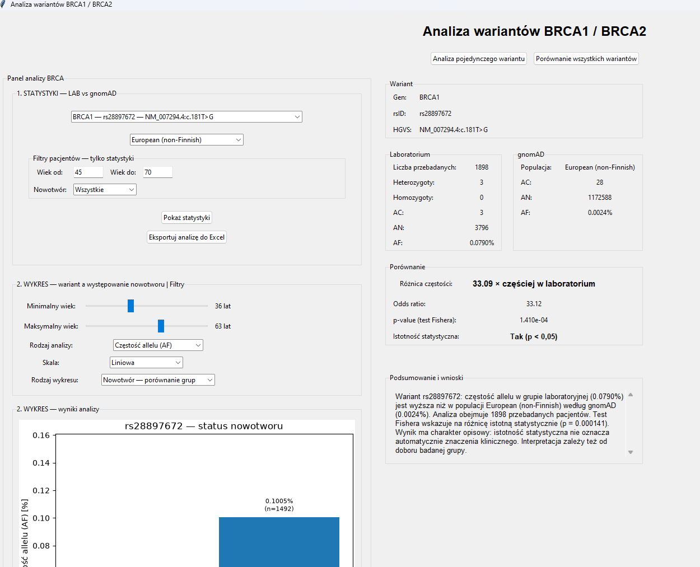
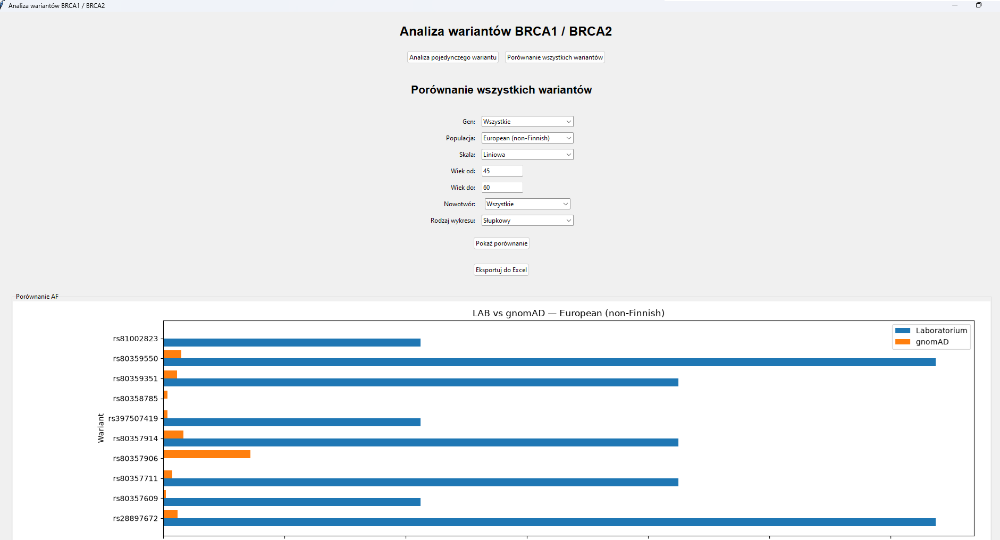

# Analiza wariantów BRCA1 / BRCA2

Aplikacja desktopowa w Pythonie służąca do analizy **syntetycznych
danych pacjentów** badanych w kierunku wariantów genów BRCA1 i BRCA2
oraz do porównania częstości alleli (AF) z danymi referencyjnymi
opisanymi jako gnomAD.

**Temat zaliczenia:**  Analiza danych medycznych pacjentów.

> **Uwaga:** Projekt ma charakter dydaktyczny. Dane pacjentów są
> syntetyczne, a uzyskane wyniki nie służą do diagnostyki ani do
> wyciągania wniosków klinicznych.

## Najważniejsze funkcje

* Dwa widoki: **Analiza pojedynczego wariantu** oraz **Porównanie
wszystkich wariantów**.
* Filtrowanie według genu, populacji referencyjnej, wieku i informacji
o występowaniu nowotworu (zależnie od widoku).
* Obliczanie częstości alleli w grupie laboratoryjnej i porównywanie
ich z częstością referencyjną.
* Obliczanie ilorazu częstości, ilorazu szans (odds ratio) i wartości
*p* testu Fishera dla pojedynczego wariantu.
* Analiza grup pacjentów z nowotworem i bez nowotworu oraz podział na
grupy wiekowe.
* Wykresy słupkowe i punktowe; na wykresie punktowym informacje o
wariancie można odczytać po najechaniu kursorem na punkt.
* Automatyczne tekstowe **podsumowanie i wnioski** dla analizy
pojedynczego wariantu.
* Eksport wyników i ustawień filtrów do plików **XLSX** z wykresami
Excela.
* Przechowywanie danych w lokalnej bazie **SQLite**.

## Technologie

Python, Tkinter/ttk (GUI), SQLite, pandas, NumPy, SciPy, Matplotlib,
openpyxl.

## Wymagania

* Python 3.10 lub nowszy (zalecany).
* System z obsługą graficznego interfejsu Tkinter.
* Pakiety z `requirements.txt`.
* Plik bazy danych `brca_database_5000.db` umieszczony w katalogu
roboczym aplikacji.

## Instalacja i uruchomienie

1. Pobierz lub sklonuj repozytorium i otwórz jego katalog.
2. Zainstaluj zależności:

&#x20;   `bash python -m pip install -r requirements.txt`

3. Upewnij się, że w katalogu znajduje się przygotowany plik
`brca_database_5000.db`.
4. Uruchom aplikację z tego katalogu:

&#x20;   `bash python main.py`

**Ważne:** w `database.py` baza jest wskazana przez względną ścieżkę
`DB_NAME = "brca_database_5000.db"`. Uruchomienie programu z innego
katalogu roboczego może skutkować błędem lub utworzeniem pustego pliku
bazy.

### Gdy gotowa baza nie jest dołączona

Do zbudowania bazy potrzebne są arkusze: -
`BRCA1_BRCA2_5000_pacjentow_wiek_nowotwor.xlsx` --- zakładki `Badania` i
`Warianty`; - `gnomAD_dane_referencyjne_BRCA1_BRCA2.xlsx` --- zakładka
`Dane_gnomAD`.

W wersji `database.py` zawierającej blok `if __name__ == "__main__":`
można uruchomić `python database.py`, aby utworzyć i wypełnić bazę.

## Jak korzystać z programu

### Analiza pojedynczego wariantu

1. Otwórz widok **Analiza pojedynczego wariantu**.
2. Wybierz wariant i populację referencyjną.
3. Ustaw opcjonalne filtry wieku i występowania nowotworu.
4. Kliknij przycisk wyświetlania statystyk.
5. Odczytaj wartości AF, wyniki testu statystycznego oraz sekcję
**Podsumowanie i wnioski**.
6. Przejrzyj wykresy i w razie potrzeby wyeksportuj analizę do XLSX.

### Porównanie wszystkich wariantów

1. Otwórz widok **Porównanie wszystkich wariantów**.
2. Wybierz populację, gen i opcjonalne filtry pacjentów.
3. Wybierz rodzaj wykresu i skalę, a następnie wyświetl wykres.
4. Na wykresie punktowym najedź na punkt, aby zobaczyć informacje o
wariancie.
5. Wyeksportuj wyniki do XLSX.

## Metody analityczne

Częstość allelu w grupie laboratoryjnej:

`AF = (liczba heterozygot + 2 × liczba homozygot) / (2 × liczba przebadanych pacjentów)`

Wartość procentowa: `AF [%] = 100 × AF`.

W analizie pojedynczego wariantu program porównuje liczbę alleli
wariantowych i pozostałych alleli w grupie laboratoryjnej oraz
referencyjnej za pomocą dwustronnego **testu dokładnego Fishera**.
Wyznacza też iloraz szans. Przyjęty w aplikacji próg istotności to
`p < 0,05`.

**Ograniczenia:** wynik zależy od doboru grupy i jakości danych
referencyjnych; wiele porównań nie jest automatycznie korygowanych pod
kątem testowania wielokrotnego. Dane syntetyczne nie pozwalają
wnioskować o rzeczywistym ryzyku zachorowania.

## Struktura projektu

``` text
projekt-brca/
├── main.py                          # interfejs użytkownika i wizualizacje
├── database.py                      # baza SQLite, zapytania i statystyki
├── brca_database_5000.db            # przykładowa baza
├── requirements.txt                 # zależności Pythona
├── README.md                        # opis projektu
├── SPECYFIKACJA_GUI.md              # specyfikacja aplikacji
└── screenshots/                     # zrzuty ekranu
    ├── analiza_wariantu.png
    └── porownanie_wariantow.png
```

## Zrzuty ekranu

### Analiza pojedynczego wariantu
 

### Porównanie wszystkich wariantów


## Wykorzystanie AI

Podczas realizacji projektu korzystano z narzędzia AI (ChatGPT) do: -
opracowania i rozwijania specyfikacji interfejsu; - generowania
fragmentów kodu Tkinter oraz logiki analitycznej; - wspomagania
tworzenia zapytań SQL, wykresów i eksportu; - diagnozowania błędów i
poprawiania interaktywności wykresów; - przygotowania dokumentacji.

Kod był iteracyjnie modyfikowany i sprawdzany podczas pracy nad
projektem.

## Repozytorium i autorstwo

* **Repozytorium GitHub:** https://github.com/ag-del59/Projekt-zaliczeniowy
* **Autor:** Agnieszka Bogucka

